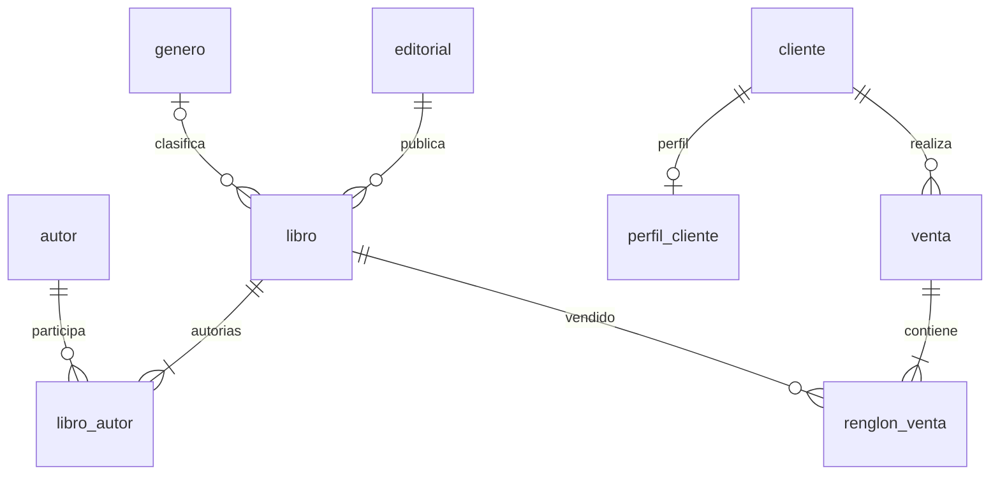

# Modelo de datos

## Dominios

- Catálogo: editoriales, géneros, autores, libros y autorías.
- Clientes: datos principales y perfil opcional.
- Ventas: cabecera y renglones con precio histórico.

Los nombres de tablas y columnas siguientes son obligatorios. No se deben quitar ni renombrar. Los IDs principales son enteros; `libro_autor` usa una clave primaria compuesta.

## ERD

Una editorial se comparte entre libros: agregación. El género también, pero es opcional. Las autorías son muchos a muchos con datos propios. Cliente/perfil es uno a uno opcional. Venta/cliente y renglón/libro son asociaciones. Venta/renglón es composición: el renglón nace dentro de la venta.

La figura 1 muestra al menos una autoría por libro; la traducción propuesta a `LibroCreate` se registra como interpretación a confirmar en el documento 10.

## Entidades

| Tabla | Columnas obligatorias | Restricciones |
|---|---|---|
| `editorial` | `id`, `nombre`, `pais` | `nombre UNIQUE` |
| `genero` | `id`, `nombre` | `nombre UNIQUE` |
| `autor` | `id`, `nombre`, `nacionalidad` | Sin restricciones extra indicadas |
| `libro` | `id`, `isbn`, `titulo`, `precio`, `stock`, `editorial_id`, `genero_id` | `isbn UNIQUE`; `precio NUMERIC(10,2) > 0`; `stock >= 0`; `genero_id` admite NULL |
| `libro_autor` | `libro_id`, `autor_id`, `rol`, `orden` | PK `(libro_id, autor_id)`; `orden >= 1`; rol en autor/coautor/traductor/ilustrador |
| `cliente` | `id`, `nombre`, `email` | `email UNIQUE` |
| `perfil_cliente` | `id`, `cliente_id`, `telefono`, `direccion` | `cliente_id UNIQUE` |
| `venta` | `id`, `cliente_id`, `fecha`, `total` | `fecha` con zona horaria; `total NUMERIC(12,2) >= 0` |
| `renglon_venta` | `id`, `venta_id`, `libro_id`, `cantidad`, `precio_unitario` | `cantidad > 0`; `precio_unitario NUMERIC(10,2) > 0` |

Textos: `str`; cantidades, stock y orden: `int`; fecha: `datetime` con zona; importes: `Decimal`, nunca `float`. Longitudes máximas y reglas adicionales sobre textos/ISBN/email no están fijadas; no presentarlas como exigencias.

### Claves foráneas e índices

| FK en tabla dependiente | Referencia | Razón / cardinalidad |
|---|---|---|
| `libro.editorial_id` | `editorial.id` | Muchos libros por editorial |
| `libro.genero_id` | `genero.id` | Muchos libros por género, opcional por libro |
| `libro_autor.libro_id` | `libro.id` | Asociación con datos |
| `libro_autor.autor_id` | `autor.id` | Asociación con datos |
| `perfil_cliente.cliente_id` | `cliente.id` | Perfil dependiente, FK única para uno a uno |
| `venta.cliente_id` | `cliente.id` | Muchas ventas por cliente |
| `renglon_venta.venta_id` | `venta.id` | Muchos renglones, cada uno pertenece a una venta |
| `renglon_venta.libro_id` | `libro.id` | El renglón referencia un libro existente |

Cada FK debe llevar un índice. Declararlo explícitamente o justificar la cobertura del índice existente al implementar; no asumir que PostgreSQL indexa una FK automáticamente.

### Navegación bidireccional

Todas las FK tienen navegación en ambos extremos mediante `Relationship(back_populates=...)`. Nombres propuestos, salvo los que el PDF utiliza expresamente:

- `Editorial.libros` ↔ `Libro.editorial`.
- `Genero.libros` ↔ `Libro.genero`.
- `Libro.autorias` ↔ `LibroAutor.libro`; `Autor.autorias` ↔ `LibroAutor.autor`.
- `Cliente.perfil` ↔ `PerfilCliente.cliente`; `Cliente.perfil` es un objeto opcional, no una lista.
- `Cliente.ventas` ↔ `Venta.cliente`.
- `Venta.renglones` ↔ `RenglonVenta.venta`.
- `Libro.renglones_venta` ↔ `RenglonVenta.libro`.

`LibroAutor` tiene clase propia y atributos; navegar mediante `libro.autorias[i].autor`. Un `link_model` que oculte rol/orden no satisface el modelo.

### Datos calculados y DTO

La venta recibe `cliente_id` y renglones con `libro_id`/`cantidad`. El servidor obtiene `precio_unitario` del libro y calcula `total` y `fecha`. El precio copiado no cambia al editar el libro. `subtotal = cantidad * precio_unitario` se muestra en la respuesta; no es columna obligatoria.

El detalle de venta incluye cliente y renglones con título del libro. El detalle de libro incluye editorial, género y autores con los datos de autoría. Evitar DTO recursivos que vuelvan a incluir el padre completo.

## Seed data inicial

La consigna exige un script/comando que deje un estado inicial conocido; no exige cargar datos cada vez que arranca la API. `create_all` crea esquema, no seed.

Propuesta para las demostraciones: editoriales, géneros, varios autores, libros con uno y varios autores y clientes, con IDs conocidos. Mantener en una base de evaluación aislada el ejemplo de cliente 2 y libros 1 y 4, con precios 25000.00 y 27000.00, para que dos ejemplares del primero y uno del segundo sumen 77000.00.

Los títulos Rayuela y Respiración artificial y sus precios son ejemplos del PDF, no catálogo obligatorio. El seed debe permitir C-01 a C-08 y D-03, sin borrar datos de la VPS ni de otro proyecto. La política de repetición/reset se decidirá antes de implementar.

## Fuente

Consigna: figura 1 y tablas de páginas 4–5, ejercicios 2/4/5 y ejemplo de página 13.
